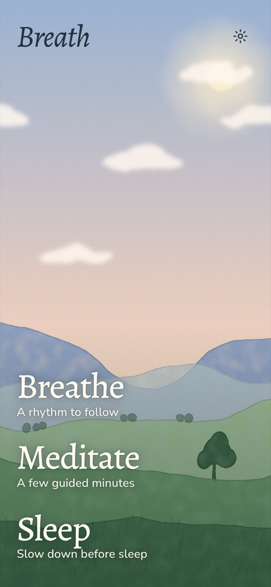
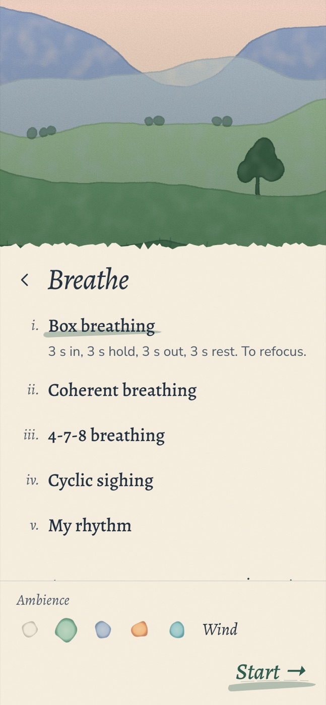
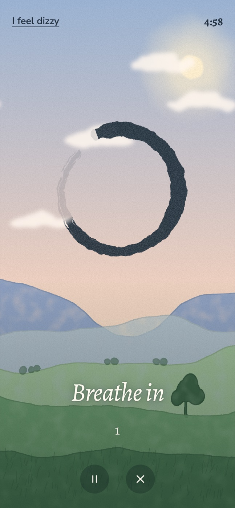
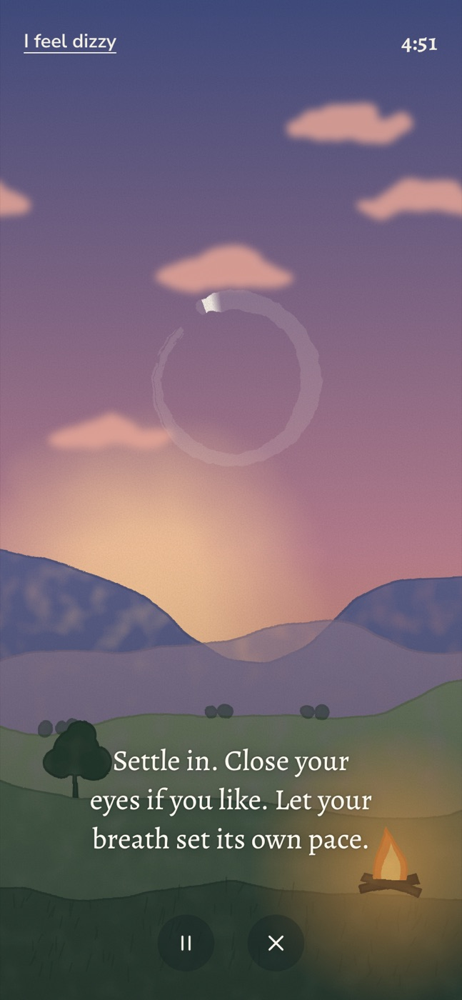
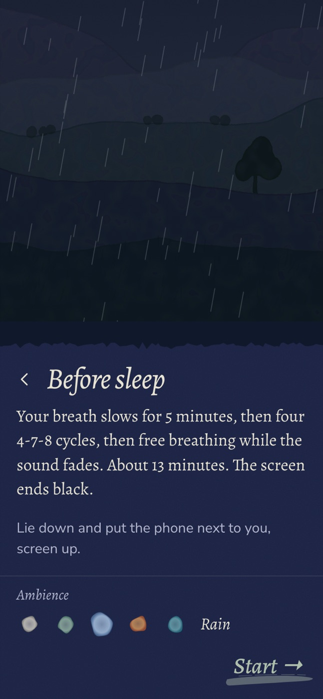

<h1 align="center">Breath</h1>

<p align="center">
  Guided breathing, short meditations and a wind-down for sleep, painted as a watercolor landscape.<br>
  A web app for the phone home screen. Works offline, no account, nothing about your sessions is stored.
</p>

<p align="center">
  <a href="https://arimet.github.io/breath/"><strong>Open Breath</strong></a> · English and French
</p>

<p align="center">
  
  
  
  
  
</p>

## Breathe

| Exercise | Rhythm | Default length |
|---|---|---|
| Box breathing | 3 s in · 3 s hold · 3 s out · 3 s rest | 5 min |
| Coherent breathing | 5 s in · 5 s out, six breaths a minute | 5 min |
| 4-7-8 breathing | 4 s in · 7 s hold · 8 s out | 4 cycles |
| Cyclic sighing | 2 s in · 1 s second sip · 6 s out | 5 min |
| My rhythm | each phase from 0 to 10 s | 1 to 20 min |

A brush ensō follows the breath. It draws itself as you breathe in, stays whole while you hold, and wipes away as you breathe out. A soft note marks each phase.

## Meditate

- **Body scan**: from the feet to the head, 5 min.
- **5-4-3-2-1 grounding**: one sense at a time, 3 min.
- **Counting breaths**: from 1 to 10, then again, 5 min.
- **Open timer**: silence between two bells, 1 to 60 min.

The guidance is written on screen; there is no voice.

## Sleep

The breath slows from 12 to 6 breaths a minute over 5 minutes, then four 4-7-8 cycles, then 6 minutes of free breathing while the sound fades out. The screen ends black. Lie down and leave the phone beside you.

## Ambiences

Wind, rain, campfire, stream or silence. The landscape follows the one you pick: rain brings a grey sky and a shower, the campfire turns the day to dusk, the stream runs down the hills. The sky also follows the mode: dawn to breathe, afternoon to meditate, night to sleep.

## Safety

A short notice is shown on first launch, and every session has an "I feel dizzy" button that stops it. Breath is not medical advice. Evidence that these techniques help you fall asleep is thin.

## Sources

- Box breathing: [Cleveland Clinic](https://health.clevelandclinic.org/box-breathing-benefits)
- Cyclic sighing and box breathing compared with mindfulness: Balban et al., *Cell Reports Medicine*, 2023 ([PMC9873947](https://pmc.ncbi.nlm.nih.gov/articles/PMC9873947))
- 4-7-8 breathing (Andrew Weil): [Cleveland Clinic](https://health.clevelandclinic.org/4-7-8-breathing)
- Resonance breathing around 6 breaths a minute: [meta-analysis, *Mindfulness*, 2024](https://link.springer.com/content/pdf/10.1007/s12671-023-02294-2.pdf)
- Breath counting: Levinson et al., *Frontiers in Psychology*, 2014 ([article](https://www.frontiersin.org/articles/10.3389/fpsyg.2014.01202/full))
- 5-4-3-2-1 grounding: [URMC](https://www.urmc.rochester.edu/behavioral-health-partners/bhp-blog/april-2018/5-4-3-2-1-coping-technique-for-anxiety)

## On iPhone

1. Open [arimet.github.io/breath](https://arimet.github.io/breath/) in Safari.
2. Share → Add to Home Screen.
3. Start a session from the new icon.

iOS stops web audio when the phone locks, so Breath keeps the screen on during a session (Screen Wake Lock, reliable for home-screen apps from iOS 18.4). Sound plays even with the silent switch on, and only after you tap Start. Web apps can't vibrate on iPhone, so cues are visual and audible only.

## Sounds

Ambient loops by Joseph Sardin, [BigSoundBank.com](https://bigsoundbank.com/), released under CC0. Details in [`public/sounds/CREDITS.md`](public/sounds/CREDITS.md). Phase notes and the bell are synthesized with the Web Audio API.

## Development

```bash
npm install
npm run dev       # http://localhost:5173, add ?speed=20 to fast-forward a session
npm test
npm run build     # dist/, with the service worker generated from sw/sw.js
```

Vanilla TypeScript and Vite, no runtime dependency.

- `src/breath/`: breathing patterns and the session timeline.
- `src/meditate/`: the guided meditation scripts.
- `src/audio/`: Web Audio notes, bell and looped ambiences.
- `src/ui/landscape.ts`: the watercolor scenes, drawn in SVG and rasterized once so only clouds, rain and firelight move.
- `src/ui/enso.ts`: the brush ensō, revealed with a conic mask.

Every push to `main` deploys to GitHub Pages through `.github/workflows/deploy.yml`.

## License

[MIT](LICENSE)
